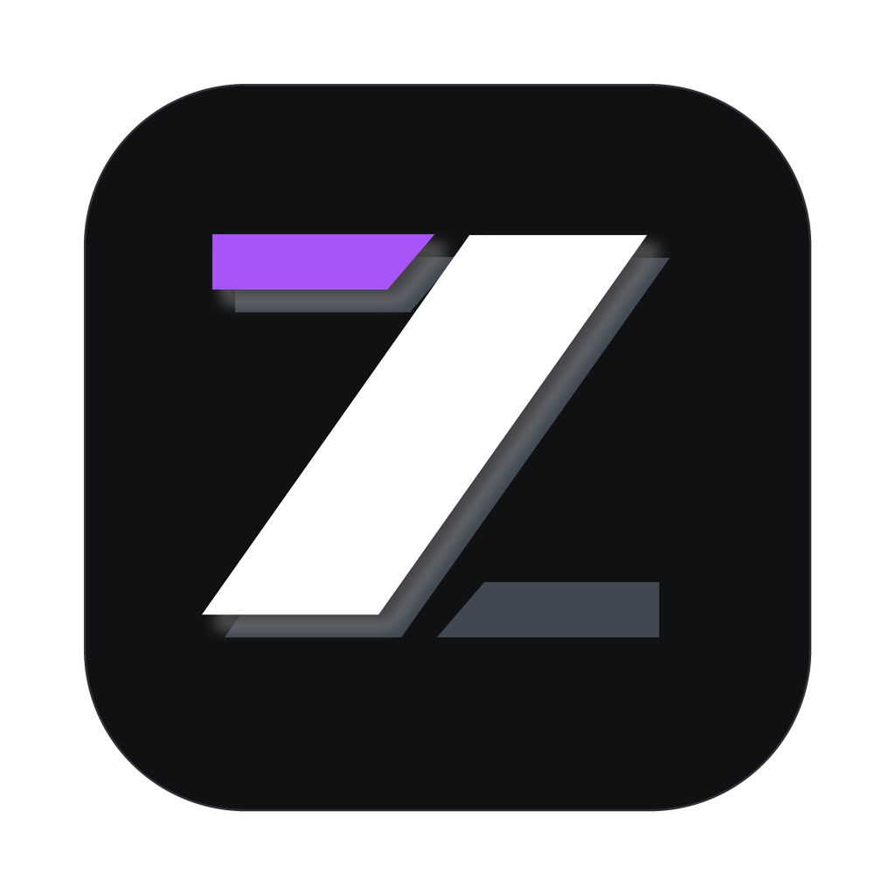

<div align="center">



# ZMod — ZCode 桌面客户端模块化扩展框架

**声明式 · 全外置 · 零构建 · 深度原生融合的 ZCode 桌面客户端模块化 Mod 加载器**

[](https://github.com/OkmiHonor/ZMod-for-ZCode/releases)
[]()
[](#-微内核架构与四通道注入)
[](LICENSE)
[](package.json)
[](#-官方精选插件生态)

<p align="center">
  <a href="#-核心亮点">核心亮点</a> •
  <a href="#-官方精选插件生态">插件生态</a> •
  <a href="#-快速上手">快速上手</a> •
  <a href="#-双通道原生管理">管理入口</a> •
  <a href="#-内置数据源系统">数据源系统</a> •
  <a href="#-极简插件开发">插件开发</a> •
  <a href="#-微内核架构与四通道注入">架构原理</a>
</p>

</div>

---

## ✨ 核心亮点

传统的客户端魔改方案往往直接将几兆代码反编译硬编码进 `app.asar` 包，不仅更新极其繁琐，还容易在官方升级时彻底损坏。ZMod 彻底吸纳 **Vencord / Spicetify** 微内核设计哲学：

- ⚡ **全外置热插拔（零接触 asar）**：宿主仅保留四处极简微纳补丁，全部运行时与插件代码 100% 存放于外置数据目录。修改插件代码无需重打包 asar，客户端内按 `Ctrl+R` 即可秒级热重载。
- 🎨 **1:1 原生 UI 深度融合**：完全继承宿主 React / Tailwind 设计语言与明暗主题 Token。官方设置页侧边栏无缝嵌入原生「ZMod」分组、苹果绿灵动开关、卡片平滑飞行微动效，浑然一体。
- 🛡️ **安全隔离与快照秒级自愈**：安装时自动快照官方纯净基线（`base/app.asar`），提供 `zmod restore` 一键秒级还原；支持 Electron 熔断（AsarIntegrity）预检与 `node-pty` / `ssh2` 原生二进制完整性守卫。
- 🔒 **硬件级凭据库（Secret Vault）**：底层调用 Electron `safeStorage`（Windows DPAPI），所有 API Key、Token 与 Cookie 强制硬件级加密落盘，非敏感配置与密钥严格隔离。
- 🧩 **特权本地协议（`zmod-local://`）**：定制标准特权协议直通外置插件；自动解析并裸导入 `@zmod/sdk`，插件源码即产物，**告别 Webpack / Vite 繁重打包**。

---

## 📦 官方精选插件生态

ZMod 提供了开箱即用的丰富插件生态，覆盖生产力、视觉美化与多模型数据集成。所有插件均在客户端内插件市场自动索引，无需手动查找：

### 🛠️ 生产力与效率（Productivity）

| 插件 ID | 插件名称 | 最新版本 | 核心能力说明 |
| :--- | :--- | :---: | :--- |
| `smart-subagent` | **子代理智能模型路由** | `v1.0.0` | 自动感知主会话订阅源，派发子代理时智能分档至同源 Flash / Haiku / Mini / Turbo 轻量模型，大幅降低 Token 消耗并提升并发吞吐。 |
| `usage-stats` | **Token 用量与费用统计** | `v1.2.0` | 非侵入拦截遥测，精细化会话分桶（跨会话防粘连）；内置 DeepSeek 2026 最新官方阶梯价表与历史消耗趋势分析。 |
| `bubble-notifications` | **任务原生气泡 HUD** | `v0.1.0` | 将 ZCode 任务状态（完成 / 报错 / 等待）通过屏幕边缘悬浮气泡原生弹出，支持停留时长与状态强调色定制。 |
| `notification-sounds` | **通知音效管理** | `v0.1.0` | 全面接管客户端提示音：音量调节、内置音色切换、自有音频文件导入、分事件配音绑定与实时试听。 |
| `prompt-snippets` | **Prompt 片段库** | `v1.1.0-beta` | 常驻快捷悬浮球，支持常用提示词面板、`{{变量}}` 占位符、Tab 键极速跳转填充与 Lexical 编辑器无缝适配。 |

### 🎨 视觉与体验（Appearance & Fun）

| 插件 ID | 插件名称 | 最新版本 | 核心能力说明 |
| :--- | :--- | :---: | :--- |
| `acrylic-window` | **亚克力背板与老板键** | `v1.4.0` | 开启 Windows 11 DWM 系统级亚克力 / 云母模糊背板（支持明暗双色透射），并提供全局快捷键一键秒藏客户端。 |
| `whale-widget` | **桌面小鲸鱼（桌宠互动）** | `v1.1.1` | 经典桌宠全面复刻：支持 ChatGPT / Claude / Gemini / Qwen / Kimi 等数十款精美换装、动画互动与模型状态联动。 |
| `qcard-fade` | **提问卡智能透明** | `v1.1.0-beta` | 向上翻阅对话历史时自动淡化折叠底部提问卡与输入框，悬停毛玻璃唤醒，重新聚焦时恢复原生状态。 |

### 🔌 数据源总览（Datasource）

| 插件 ID | 插件名称 | 最新版本 | 核心能力说明 |
| :--- | :--- | :---: | :--- |
| `quota-popover` | **余量弹窗与模型页总览** | `v1.4.2` | 输入框「上下文容量」悬浮窗注入今日余额卡（v1 token-monitor 1:1），并在官方「模型设置」页内直观展示各供应商额度。 |

> 💡 **插件安装渠道**：所有插件支持在应用内一键下载更新，也可以在 [Plugins Release](https://github.com/OkmiHonor/ZMod-for-ZCode/releases/tag/plugins) 下载独立 zip 包，直接拖拽进客户端设置页完成安装。

---

## 🚀 快速上手

### 方式一：一键安装器（普通用户推荐）

1. 从 [GitHub Releases](https://github.com/OkmiHonor/ZMod-for-ZCode/releases) 下载最新版本的 `ZMod-Setup.exe`。
2. 双击运行安装包。安装器体积仅 ~1MB，**无需预装 Node.js**（若系统无 Node，会自动调用 ZCode 自身运行时隐藏执行）。
3. 安装完成后启动 ZCode 即可直接体验。

### 方式二：开发者源码与 CLI

```bash
# 1. 克隆代码仓库
git clone https://github.com/OkmiHonor/ZMod-for-ZCode.git zmod
cd zmod && npm install

# 2. 环境诊断（检查 Node、宿主路径、asar 完整性与熔断哨兵）
npm run doctor

# 3. 一键安装（自动备份纯净基线到 base/app.asar）
npm run install-mod

# 若客户端正在运行，可追加参数自动终止并在安装后自动重启：
npm run install-mod -- --force

# 4. 一键秒级还原纯净客户端（任何时候无损恢复官方原版）
npm run restore

# 5. 运行完整自动化测试套件
npm test
```

> **宿主自动探测机制**：ZMod CLI 按以下优先级自动发现 ZCode 客户端安装位置：
> `--path` 参数 > `config.json` 记录 > `ZCODE_PATH` 环境变量 > 平台标准安装目录 > 正在运行的 ZCode 进程反推（无论装在哪个盘都能自动识别）。

---

## 🎮 双通道原生管理

ZMod 提供双层控制入口，兼顾深度视觉融合与高可用兜底：

```text
┌────────────────────────────────────────────────────────┐
│ 入口 1：官方设置页（推荐）                              │
│ 启动客户端 → 打开设置 → 侧栏「ZMod」原生分区            │
│  ├─ 扩展插件：苹果绿开关、平滑飞行卡片、支持批量拖入安装 │
│  └─ 数据源：多供应商实例配置、DPAPI 密钥保管            │
├────────────────────────────────────────────────────────┤
│ 入口 2：全局快捷键面板（兜底）                          │
│ 任何界面下按下「Ctrl + Shift + M」                      │
│ 唤起独立浮层管理面板（已装插件 + 插件市场），全环境兼容  │
└────────────────────────────────────────────────────────┘
```

- **批量拖拽安装**：在设置页「扩展插件」区域，直接把下载的 `.zip` 插件包或解压文件夹拖入窗口，框架将自动完成安全校验、解压分拣、原子记账与即时装载。

---

## 🔌 内置数据源系统（Datasource Engine）

ZMod 彻底解耦额度采集与 UI 展示，采用「Provider（类型适配器）+ Instance（用户实例）」设计模型：

```text
 Provider（基座内置 / 插件扩展适配器）              Instance（用户在设置页配置的具体实例）
┌─────────────────────────────────────┐            ┌────────────────────────────────────┐
│ • custom-http (通用 REST JSON 接口) │            │ • 实例 A：我的聚合 API 网关        │
│ • openai-compatible (OpenAI 反代)   │◀───类型────│ • 实例 B：阿里云百炼企业空间       │
│ • console-web (Cookie 控制台采集)   │            │ • 实例 C：DeepSeek 专属结算账号    │
│ • deepseek / antigravity / mimo     │            │                                    │
│ • bailian-bss / official-account    │◀───查询────│ 凭据（Token/Cookie）DPAPI 硬件加密 │
└─────────────────────────────────────┘            └────────────────────────────────────┘
                   │
                   ▼ 统一状态分发
┌───────────────────────────────────────────────────────────────────────────────────────┐
│ 消费端插件（quota-popover / usage-stats / whale-widget）                               │
│ • 共享缓存：同源请求 60s 内合并复用，防止频繁轮询封号                                 │
│ • 主进程 HTTP 隧道：经由 RPC net.fetch 绕过浏览器同源策略（CORS）与 Header 限制      │
└───────────────────────────────────────────────────────────────────────────────────────┘
```

- **出厂即用**：基座内置 8 大主流类型适配器，无需安装任何额外插件即可直接添加实例；
- **凭据永不明文**：所有标注为 `secret` 的敏感输入经 Electron `safeStorage` 加密后写入独立的 `secure.vault` 二进制库，`config.json` 中仅保留非敏感字段。

---

## 🛠️ 极简插件开发（零构建，1 分钟上手）

> 💡 **开发者必读指南**：
> - 规范详情：[**插件开发标准规范与四类实现范式 (A/B/C/D)**](./docs/plugin-development-standards.md)
> - 完整走查：[**插件作者上手实战手册**](./docs/plugin-author-guide.md)
> - 规范协议：[**插件清单契约 (plugin-spec.md)**](./docs/plugin-spec.md)

无需配置 Webpack / Babel / Vite，只需新建一个包含 `manifest.json` 与 `index.js` 的目录即可被 ZMod 加载：

```javascript
// plugins/my-glow-plugin/index.js
import { definePlugin } from '@zmod/sdk';

export default definePlugin({
  id: 'my-glow-plugin',
  name: '输入框呼吸光晕',
  description: '为聊天输入框增加可调节的呼吸光晕效果',
  version: '1.0.0',

  // 1. 声明式配置：设置页与管理面板自动生成原生控件，数据自动持久化
  settings: {
    intensity: { type: 'slider', title: '光晕强度', default: 50, min: 10, max: 100 },
    color: { type: 'color', title: '光晕色彩', default: '#3b82f6' },
    secretToken: { type: 'secret', title: '认证密钥', description: '硬件级安全加密存储' }
  },

  // 2. 插件生命周期：激活与装载
  async start(ctx) {
    const { settings, ui, cleanup } = ctx;

    const renderGlow = () => {
      const radius = settings.get('intensity', 50);
      const color = settings.get('color', '#3b82f6');
      ui.injectStyle('my-glow-style', `
        .composer { box-shadow: 0 0 ${radius}px ${color} !important; transition: box-shadow .2s ease; }
      `);
    };

    renderGlow();
    // 实时监听配置变化
    settings.onChange('intensity', renderGlow);
    settings.onChange('color', renderGlow);

    // 3. 资源回收：当插件被停用时，注册的 cleanup 函数将按 LIFO 逆序自动销毁
    cleanup(() => ui.removeStyle('my-glow-style'));
  }
});
```

### CLI 脚手架与常用指令

```bash
# 生成标准模板插件
npx zmod plugin init my-new-plugin

# 调试与管理
npx zmod plugin list                          # 查看本地已装插件与激活状态
npx zmod plugin search <关键词>               # 搜索官方市场插件
npx zmod plugin install <zip路径|目录|git>    # 安装新插件
npx zmod plugin update [id]                   # 升级插件版本
npx zmod plugin remove <id>                   # 卸载插件（保留用户配置）
npx zmod plugin enable / disable <id>         # 快速启用/禁用
```

---

## 🏗️ 微内核架构与四通道注入

```text
ZCode 客户端宿主 (app.asar — 仅 4 处微纳补丁，零硬编码业务逻辑)
├── out/main/index.js        ← 头部：注册 zmod-local:// 特权协议 | 尾部：动态挂载外置运行时
├── out/preload/index.cjs    ← 尾部：通过 contextBridge 注入安全进程通信桥 (zmodAPI)
└── out/renderer/index.html  ← 尾部：插入 <script type="module" src="zmod-local://core/index.js">

<ZMod 安装目录>/data/ (全外置运行时工作区，版本升级完全解耦)
├── runtime/
│   ├── main/                ← 主进程微内核：特权协议路由、RPC 通信网关、DPAPI 加密保险库
│   ├── core/index.js        ← 渲染层微内核：插件调度注册表、原生设置页注入、市场视图
│   └── sdk/                 ← @zmod/sdk (definePlugin 运行时与 Schema 校验器)
├── plugins/<id>/            ← 独立插件存储区 (ESModule 源码即产物)
├── config.json              ← 插件声明式配置明文持久化文件
├── secure.vault             ← DPAPI 硬件加密密钥库 (二进制存储)
└── base/app.asar            ← 官方纯净基线快照 (提供一键秒级 restore 还原保障)
```

---

## ❓ 常见问题 (FAQ)

<details>
<summary><b>Q: 官方 ZCode 客户端自动更新后，ZMod 会失效吗？</b></summary>
<br>
当官方客户端版本更新时，其自带的 <code>app.asar</code> 会被官方新版本覆盖，四通道微补丁会自然失效。此时只需运行一次 <code>zmod install</code>（或重新运行安装器），ZMod 会识别新的官方基线并瞬间重新挂载，您的所有插件代码、配置与数据源凭据完好无损。
</details>

<details>
<summary><b>Q: 如果想完全卸载 ZMod，怎样恢复到最干净的原厂状态？</b></summary>
<br>
运行命令 <code>npm run restore</code>（或使用安装器的卸载程序），框架会直接用首次安装时备份的纯净基线快照 <code>base/app.asar</code> 覆盖写回，1 秒钟恢复官方出厂状态，绝无任何残留文件修改。
</details>

<details>
<summary><b>Q: 安装器为什么不需要预装 Node.js 环境？</b></summary>
<br>
安装器内置了精密的解释器发现链。如果用户电脑上没有全局 Node.js，NSIS 安装脚本会自动借用 ZCode 自带的 Electron 主程序（通过注入 <code>ELECTRON_RUN_AS_NODE=1</code> 环境变量把 Electron 当作 Node 执行器），做到完全免依赖、开箱即用。
</details>

---

## 📄 开源许可证

本项目基于 [MIT License](LICENSE) 协议开源。
